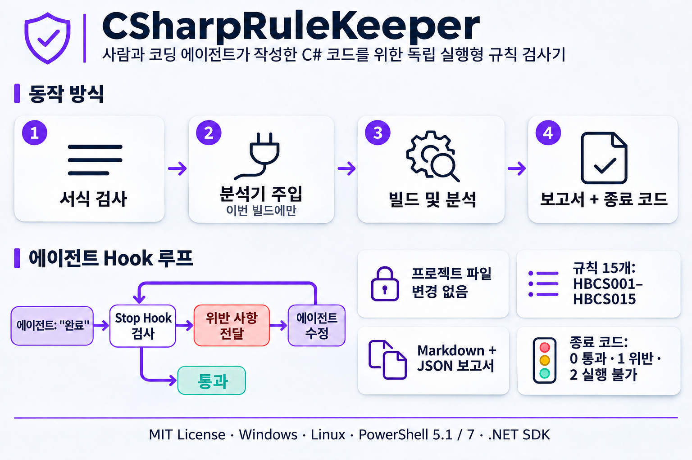

# CSharpRuleKeeper

[English](README.md) ·    



CSharpRuleKeeper는 C# 코드를 명명·길이·레이아웃에 관한 규칙 15개로 검사한다. 어떤 솔루션이나 프로젝트든 파일을 고치지 않고 명령줄에서 검사하며, Claude Code나 Codex CLI의 Stop 훅에 연결하면 "끝났다"고 말한 코딩 에이전트에게 위반을 돌려보내 멈추기 전에 고치게 한다.

## 나에게 맞는 도구인가

이것은 **한 개발자의 관례를 담은, 주관이 뚜렷한 규칙 모음**이다. 예를 들어 `int` 대신 `Int32`, 추상 클래스 이름은 `...Base`, private 필드는 `_camelCase`, 코드 줄 끝에는 주석을 두지 않기를 요구한다. 모든 규칙은 `.editorconfig`로 끄거나, 심각도를 낮추거나, 기준을 조정할 수 있다([설정](docs/ko/CONFIGURATION.md)).

- **맞는 경우**: C# 코드에 코딩 에이전트를 쓰며 에이전트가 정해진 스타일을 자동으로 지키게 하고 싶을 때, 또는 종료 코드가 분명한 스크립트용 검사가 필요할 때. Windows(Windows PowerShell 5.1 또는 PowerShell 7)나 Linux(PowerShell 7)에서 쓴다. macOS는 구현했지만 검증하지 않았다([요구 사항](#요구-사항)).
- **맞지 않는 경우**: 폭넓은 커뮤니티 표준 규칙 라이브러리를 원할 때(.NET Analyzer, StyleCop, Roslynator를 쓴다), 입력하는 동안의 실시간 분석이 필요할 때, PowerShell 없이 쓰는 도구를 원할 때.

`HBCS001`...`HBCS015`는 규칙 ID이며 `HBCS`는 이 프로젝트의 진단 접두사일 뿐이다. 옵션은 `personal_csharp_rules.`로 시작하는 `.editorconfig` 키이며, 이 이름은 규칙이 개인 관례에서 출발한 데서 왔다.

## 동작 방식

1. `dotnet format whitespace --verify-no-changes`로 대상의 `.editorconfig`에 맞는지 공백 서식을 검사한다(`-Fix`를 주지 않으면 읽기 전용).
2. MSBuild 속성으로 이번 빌드에만 Analyzer를 붙인다. `.csproj`, `.sln`, props 파일, `.editorconfig`를 고치지 않으며 프로젝트에 아무것도 설치하지 않는다.
3. 대상은 자체 SDK와 target framework로 빌드된다(`--no-incremental`이므로 대상의 `bin`, `obj` 폴더는 다시 만들어진다).
4. 검사기는 모든 프로젝트 빌드에서 Analyzer가 실제로 실행됐음을 확인한 뒤 Markdown 보고서, JSON 결과, 종료 코드를 남긴다.

## 설치

문서에서는 도구 폴더를 `C:\tools\CSharpRuleKeeper`(Windows)와 `~/tools/CSharpRuleKeeper`(Linux, macOS)로 적는다. 원하는 폴더를 써도 된다.

- **소스에서 (지금 바로 가능).** Analyzer 빌드에 .NET 10 SDK 10.0.400 이상이 필요하며, 첫 검사 때 자동으로 빌드된다.

  ```powershell
  git clone https://github.com/jacking75/CSharpRuleKeeper.git C:\tools\CSharpRuleKeeper
  # Linux, macOS:
  git clone https://github.com/jacking75/CSharpRuleKeeper.git ~/tools/CSharpRuleKeeper
  ```

- **릴리스 ZIP.** [Releases 페이지](https://github.com/jacking75/CSharpRuleKeeper/releases)에 릴리스가 올라와 있으면 `CSharpRuleKeeper-<version>.zip`을 받는다. 압축을 풀면 미리 빌드한 Analyzer가 든 `CSharpRuleKeeper-<version>/` 폴더 하나가 나오며, 도구 자체에는 SDK가 필요 없다. 같은 ZIP을 모든 OS에서 쓴다. 첫 릴리스가 나오기 전에는 소스 방식을 쓴다.

어느 쪽이든 PowerShell(Windows PowerShell 5.1 또는 PowerShell 7 `pwsh`)과, 대상이 이미 빌드에 쓰는 SDK(8.0.100 이상)가 필요하다. 자세한 내용: [시작하기](docs/ko/GETTING_STARTED.md#1-도구-받기).

## 빠른 시작

Windows, Windows PowerShell 5.1(Windows의 PowerShell 7에서는 `powershell` 대신 `pwsh`를 쓴다):

```powershell
# 1. 환경 확인 (읽기 전용)
powershell -NoProfile -ExecutionPolicy Bypass -File C:\tools\CSharpRuleKeeper\build\Invoke-CSharpRuleKeeper.ps1 -Doctor -Solution .\MySolution.sln

# 2. 검사 실행
powershell -NoProfile -ExecutionPolicy Bypass -File C:\tools\CSharpRuleKeeper\build\Invoke-CSharpRuleKeeper.ps1 -Solution .\MySolution.sln -OutputPath .\report.md

# 3. 보고서를 읽고 위치를 고친 뒤 2번을 다시 실행
notepad .\report.md
```

Linux와 macOS, PowerShell 7(여기서는 `-ExecutionPolicy`가 필요 없다):

```bash
pwsh -NoProfile -File ~/tools/CSharpRuleKeeper/build/Invoke-CSharpRuleKeeper.ps1 -Doctor -Solution ./MySolution.sln
pwsh -NoProfile -File ~/tools/CSharpRuleKeeper/build/Invoke-CSharpRuleKeeper.ps1 -Solution ./MySolution.sln -OutputPath ./report.md
```

문서의 다른 명령은 Windows PowerShell 기준이므로 같은 방식으로 바꿔 쓴다. `-Solution`에는 `.sln`, `.slnx`, `.csproj`, 또는 그중 하나가 든 폴더를 준다. 모든 옵션과 동봉된 샘플로 연습하는 방법은 [시작하기](docs/ko/GETTING_STARTED.md)에 있다.

보고서의 진단 하나(실제 출력, 보고서는 영어로 출력된다):

```markdown
## HBCS001 · error · new

- Location: `RuleViolations.cs:8:18`
- Project/TFM: `SampleConsumer` / `net10.0`
- Diagnostic: Public field 'Count' must be replaced or explicitly excepted
- Verdict: affects the verdict
- Help: https://github.com/jacking75/CSharpRuleKeeper/blob/main/docs/RULES.md#hbcs001
- Fix caution: Review external API, serialization and interop contracts, and encapsulate only when it is safe.
```

## 종료 코드

| 코드 | 뜻 |
| --- | --- |
| `0` | 통과: 검사가 끝났고 판정에 반영되는 진단이 없다. |
| `1` | 위반: 검사가 끝났고 `-FailOn`(기본 `warning`) 이상의 HBCS 진단이나 공백 서식 차이가 있다. |
| `2` | 실행하거나 끝내지 못함: 잘못된 인수, SDK 없음, 컴파일 오류, 분석되지 않은 프로젝트, 시간 초과 등. |

진단 0개는 분석 완료가 아니다. JSON의 `analysisCompleted`를 확인한다. 전체 계약은 [보고서](docs/ko/REPORT.md)에 있다.

## 코딩 에이전트 훅으로 쓰기

에이전트가 작업을 마치면 Stop 훅이 검사를 실행한다. 위반은 차단 사유로 에이전트에게 돌아가고, 연속 3번 차단한 뒤에는 에이전트를 멈추게 두고 사람에게 알린다. 에이전트가 고칠 수 없는 문제(SDK 없음, 시간 초과)는 사람에게 보여 줄 뿐 차단하지 않는다.

Windows의 Claude Code `.claude/settings.json`:

```json
{
  "hooks": {
    "Stop": [
      {
        "hooks": [
          {
            "type": "command",
            "command": "powershell.exe",
            "args": ["-NoProfile", "-ExecutionPolicy", "Bypass", "-File", "C:\\tools\\CSharpRuleKeeper\\build\\Invoke-CSharpRuleKeeperHook.ps1"],
            "timeout": 900
          }
        ]
      }
    ]
  }
}
```

Windows의 PowerShell 7에서는 `"command": "pwsh.exe"`로 쓴다. Linux와 macOS에서는 `"command": "pwsh"`와 `"args": ["-NoProfile", "-File", "/home/you/tools/CSharpRuleKeeper/build/Invoke-CSharpRuleKeeperHook.ps1"]`를 쓴다([`hooks/claude-code/settings.pwsh.example.json`](hooks/claude-code/settings.pwsh.example.json)). Linux와 macOS에서는 stdin으로 훅 페이로드를 넣어 어댑터를 테스트했을 뿐, Claude Code와 Codex CLI 자체로 실행해 보지는 않았다.

훅은 에이전트가 바꾼 파일만이 아니라 **솔루션 전체**를 검사한다. 따라서 기존 코드베이스에서는 기준선부터 만든다([훅: 기존 코드베이스](docs/ko/HOOKS.md#기존-코드베이스에-훅-도입하기)). 훅은 솔루션을 스스로 찾고, git 저장소에서는 마지막 통과 이후 바뀐 것이 없으면 검사를 건너뛰며, 코드를 포맷하거나 수정하지 않는다. Codex CLI 설정과 프로젝트의 `AGENTS.md`/`CLAUDE.md`에 넣을 문단은 [`hooks/`](hooks/README.md)에, 나머지는 [훅](docs/ko/HOOKS.md)에 있다.

## 규칙

| ID | 규칙 | 기본 심각도 |
| --- | --- | --- |
| [HBCS001](docs/ko/RULES.md#hbcs001) | 예외가 없는 public 필드 금지 | error |
| [HBCS002](docs/ko/RULES.md#hbcs002) | boolean 이름은 `is`/`has`/`can`/`should`/`needs`로 시작 | warning |
| [HBCS003](docs/ko/RULES.md#hbcs003) | 컬렉션 이름은 복수형 | warning |
| [HBCS004](docs/ko/RULES.md#hbcs004) | 식별자 문자열 대신 `nameof` (Code Fix 있음) | warning |
| [HBCS005](docs/ko/RULES.md#hbcs005) | 매직 넘버 금지 | warning |
| [HBCS006](docs/ko/RULES.md#hbcs006) | 메서드 길이 | 30줄 초과 warning, 100줄 초과 error |
| [HBCS007](docs/ko/RULES.md#hbcs007) | 타입 길이 | 300줄 초과 warning, 500줄 초과 error |
| [HBCS008](docs/ko/RULES.md#hbcs008) | 불필요한 `private` 생략 | info |
| [HBCS009](docs/ko/RULES.md#hbcs009) | 코드 줄 끝 주석 금지 | warning |
| [HBCS010](docs/ko/RULES.md#hbcs010) | 연속된 빈 줄 금지 | warning |
| [HBCS011](docs/ko/RULES.md#hbcs011) | `int`/`long`/`uint`/`ulong` 대신 `Int32`/`Int64`/`UInt32`/`UInt64` | warning |
| [HBCS012](docs/ko/RULES.md#hbcs012) | 줄 길이 | 120자 초과 warning |
| [HBCS013](docs/ko/RULES.md#hbcs013) | `I...` 인터페이스, `...Attribute`, `...Base` 추상 클래스, `...Async` 메서드 | warning |
| [HBCS014](docs/ko/RULES.md#hbcs014) | 필드 접두사 `_`, `s_`, `t_` | error |
| [HBCS015](docs/ko/RULES.md#hbcs015) | 소스 파일 길이 | 500줄 초과 warning, 1000줄 초과 error |

생성 코드는 분석하지 않는다. 설정 진단 [HBCS900](docs/ko/RULES.md#hbcs900)은 `.editorconfig`의 잘못된 옵션 값을 알린다. 코딩 규칙이 아니며 판정에 영향을 주지 않는다. 공개한 규칙 ID의 의미와 기본 심각도는 호환성 검토 없이 바꾸지 않는다.

## 설정과 도입

대상의 `.editorconfig`에서 규칙을 조정한다.

```ini
[*.cs]
personal_csharp_rules.method_lines_warning = 40
personal_csharp_rules.method_lines_error = 120
dotnet_diagnostic.HBCS011.severity = none
```

기존 위반이 있는 코드베이스에서는 한 번 기록해 두고 새 진단에만 실패하게 한다.

```powershell
powershell -NoProfile -ExecutionPolicy Bypass -File C:\tools\CSharpRuleKeeper\build\Invoke-CSharpRuleKeeper.ps1 -Solution .\MySolution.sln -BaselinePath .\csharprulekeeper-baseline.json -CreateBaseline
powershell -NoProfile -ExecutionPolicy Bypass -File C:\tools\CSharpRuleKeeper\build\Invoke-CSharpRuleKeeper.ps1 -Solution .\MySolution.sln -BaselinePath .\csharprulekeeper-baseline.json
```

대조 방식과 정확하지 않게 되는 경우: [보고서: 기준선](docs/ko/REPORT.md#기준선). 전체 옵션, 심각도, 억제, 다른 Analyzer와의 충돌: [설정](docs/ko/CONFIGURATION.md).

## 요구 사항

- PowerShell. 같은 스크립트가 지원하는 모든 조합에서 실행되며, 1.2.0 기준 상태는 다음과 같다.

  | OS | PowerShell | 상태 |
  | --- | --- | --- |
  | Windows | Windows PowerShell 5.1 | 검증함. |
  | Windows | PowerShell 7 | 7.7.0으로 검증함. |
  | Linux | PowerShell 7 | WSL2의 Ubuntu 24.04에서 7.7.0으로 검증함. 다른 배포판은 테스트하지 않았다. |
  | macOS | PowerShell 7 | 구현했지만 **검증하지 않음**: Mac을 쓸 수 없었다. 확인한 내용을 알려 주기 바란다. |

  "검증함"은 그 환경에서 품질 게이트(단위 테스트, 스크립트 계약 테스트, 자기 검사)와 문서의 명령이 통과했다는 뜻이다. 에이전트 훅은 Linux에서 stdin으로 훅 페이로드를 넣어 어댑터를 테스트했을 뿐, Claude Code나 Codex CLI를 실행해 보지는 않았다.
- 대상은 설치된 자체 SDK로 빌드된다. Analyzer에는 .NET SDK 8.0.100 이상의 컴파일러가 필요하다. 더 오래된 SDK에서는 컴파일러가 Analyzer를 건너뛰며(경고 CS9057), 검사기는 거짓 통과 대신 종료 코드 2를 낸다.
- 소스 체크아웃은 Analyzer 빌드를 위해 .NET 10 SDK 10.0.400 이상도 필요하다(`global.json`이 이후 10.0 기능 대역으로 롤포워드한다). 릴리스 ZIP은 필요 없다.

## FAQ

- **내 파일을 바꾸나?** 추적되는 파일은 건드리지 않는다. 예외는 `-Fix`이며 공백 서식만 적용한다. 빌드는 대상의 `bin`, `obj` 출력을 다시 쓰고, 검사기는 `-OutputPath`가 가리키는 곳에 보고서를 쓰며, 훅은 자체 `.gitignore`가 든 `.csharprulekeeper\`에 보고서를 둔다.
- **StyleCop, Roslynator, `.editorconfig`만 쓰는 것과 무엇이 다른가?** 그것들은 프로젝트에 추가하는 폭넓은 규칙 라이브러리다. 이 도구는 작고 고정된 규칙 모음과, 어떤 솔루션이든 고치지 않고 검사하며 분석이 실제로 실행됐음을 확인하고 에이전트 훅 프로토콜로 답하는 실행기다. 일부 규칙은 흔한 규칙과 겹치거나 충돌한다. [공존](docs/ko/CONFIGURATION.md#다른-analyzer와-함께-쓰기)을 본다.
- **일부 규칙만 쓸 수 있나?** 그렇다. 나머지를 `.editorconfig`에서 `none`으로 두거나, `-FailOn error`로 error 심각도 진단만 실패시킨다.
- **CI에서 쓸 수 있나?** 종료 코드와 JSON 결과가 있는 명령이므로 PowerShell과 SDK가 있는 빌드 에이전트라면 실행할 수 있다. Windows PowerShell 5.1이나 PowerShell 7의 Windows, 또는 PowerShell 7의 Linux다. CI 워크플로는 제공하지 않는다.
- **Linux, macOS, PowerShell 7에서 실행되나?** 그렇다. 같은 파일을 `powershell` 대신 `pwsh`로 실행하면 되고, 하위 프로세스(훅이 실행하는 검사기)도 같은 PowerShell을 쓴다. Linux는 WSL2의 Ubuntu 24.04에서만 검증했고, macOS는 전혀 테스트하지 않았다([요구 사항](#요구-사항)). 보고서 경로는 검사를 실행한 OS의 구분자를 쓰며, 한 OS에서 만든 기준선은 다른 OS의 같은 진단과 맞는다([보고서: 기준선](docs/ko/REPORT.md#기준선)).
- **NuGet 패키지가 있나?** 게시한 패키지는 없다. `dotnet pack src/CSharpRuleKeeper.CodeFixes -c Release`로 모든 Analyzer와 HBCS004 Code Fix가 든 로컬 패키지를 만들 수 있다. 그때는 일반 Analyzer 패키지처럼 동작해 error 심각도 규칙이 빌드를 깨뜨린다. IDE에서 Code Fix가 로드되는지는 검증하지 않았다.
- **왜 PowerShell인가?** Windows PowerShell 5.1은 Windows에 기본으로 들어 있어 Windows에서는 .NET SDK 외에 필요한 것이 없다. Linux와 macOS에서는 PowerShell 7이 같은 스크립트를 실행한다.
- **느린가?** 대상을 한 번 깨끗이 빌드하는 시간에 몇 초가 더해진다. 유지보수자 PC에서 작은 샘플 프로젝트는 14~20초였다.

## 문서

[시작하기](docs/ko/GETTING_STARTED.md) · [규칙](docs/ko/RULES.md) · [설정](docs/ko/CONFIGURATION.md) · [훅](docs/ko/HOOKS.md) · [보고서와 종료 코드](docs/ko/REPORT.md) · [문제 해결](docs/ko/TROUBLESHOOTING.md)

## 저장소 구성

```text
src/CSharpRuleKeeper.Analyzers   규칙과 Analyzer (netstandard2.0)
src/CSharpRuleKeeper.CodeFixes   HBCS004 Code Fix와 NuGet 패키징
build/                           검사기, 훅 어댑터, 보고서, 테스트, 번들 스크립트
hooks/                           에이전트 훅 예제와 지시문
docs/  docs/ko/                  문서 (영어 / 한국어)
config/presets/                  .editorconfig preset
samples/SampleConsumer           연습용 프로젝트
tests/                           Analyzer 단위 테스트
```

## 개발, 기여, 보안, 라이선스

```powershell
dotnet format --verify-no-changes
dotnet build
dotnet test
.\build\run-quality-gate.ps1
```

PowerShell 7에서는 게이트를 `pwsh -NoProfile -File ./build/run-quality-gate.ps1`로 실행한다. 품질 게이트는 복원, 서식 검사, 빌드, 테스트, 스크립트 계약 테스트를 실행하고 이 저장소를 도구 자신으로 검사하며, 진단이 0건이어야 한다. [CONTRIBUTING.md](CONTRIBUTING.md), [유지보수 안내](docs/ko/MAINTAINERS.md), [CHANGELOG.md](CHANGELOG.md)를 본다. 취약점은 [SECURITY.md](SECURITY.md)에 적힌 대로 비공개로 보고하고, [행동 강령](CODE_OF_CONDUCT.md)은 프로젝트의 모든 공간에 적용된다. 라이선스는 [MIT License](LICENSE)다.
